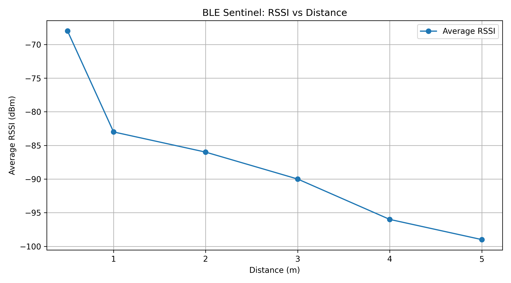

# BLE Sentinel 🔵

### ESP32-Based Bluetooth Low Energy Monitoring, Proximity Analysis & Device Discovery


BLE Sentinel is a hands-on wireless technology research project built around an ESP32-WROOM-32U development board. The project explores Bluetooth Low Energy (BLE) communication, custom GATT services, real-time notifications, signal-strength measurements, proximity classification, and nearby BLE device discovery.

It combines embedded programming with Python-based analysis to investigate how BLE devices advertise their presence, communicate with connected clients, and exhibit changes in received signal strength under different experimental conditions.

The project is being developed incrementally, with each version introducing and testing additional functionality.

---

## 📑 Table of Contents

- [Project Objectives](#-project-objectives)
- [Features](#-features)
- [Hardware and Software](#-hardware-and-software)
- [Repository Structure](#-repository-structure)
- [System Overview](#-system-overview)
- [Firmware Versions](#-firmware-versions)
- [BLE GATT Service](#-ble-gatt-service)
- [RSSI Experiment](#-rssi-experiment)
- [RSSI Classification](#-rssi-classification)
- [Python Analysis Tools](#-python-analysis-tools)
- [BLE Device Discovery and Inventory](#-ble-device-discovery-and-inventory)
- [Setup and Installation](#-setup-and-installation)
- [Testing with an iPhone](#-testing-with-an-iphone)
- [Experimental Limitations](#-experimental-limitations)
- [Security and Privacy Considerations](#-security-and-privacy-considerations)
- [Future Improvements](#-future-improvements)
- [Author](#-author)
- [License](#-license)

---

## 🎯 Project Objectives

The main objectives of BLE Sentinel are to:

- Develop a custom BLE GATT service using an ESP32.
- Expose device status information through a readable characteristic.
- Implement notifications for periodically updated device information.
- Measure and record BLE Received Signal Strength Indicator (RSSI) values.
- Investigate the relationship between RSSI and physical distance.
- Experiment with RSSI-based proximity classification.
- Record RSSI measurements with timestamps using Python.
- Scan for nearby BLE advertisements.
- Build a basic inventory of observed BLE device addresses.
- Develop practical experience in embedded systems, wireless communication, and data analysis.

---

## ✨ Features

### 1. BLE Beacon and GATT Server

- Advertises the ESP32 as `BLE-SENTINEL`.
- Provides a custom BLE GATT service.
- Exposes a readable characteristic containing device status information.
- Allows compatible BLE clients to discover and connect to the device.

### 2. Real-Time BLE Notifications

- Supports characteristic notifications.
- Periodically updates device status information.
- Reports uptime and available heap memory.
- Uses a BLE descriptor to support notification configuration by compatible clients.

### 3. Connection Monitoring

- Displays connection duration in `HH:MM:SS` format.
- Tracks the duration of the active connection.
- Restarts BLE advertising after disconnection.

### 4. RSSI Measurement and Analysis

- Records RSSI readings observed through a mobile BLE application.
- Compares signal strength across several measured distances.
- Uses Python to calculate average readings and generate a graph.
- Explores how signal strength changes as the distance between devices increases.

### 5. RSSI-Based Classification

- Classifies RSSI readings into three experimental categories:
  - STRONG
  - MODERATE
  - WEAK
- Provides an interactive Python script for testing RSSI values.

### 6. RSSI Measurement Logging

- Accepts manually entered RSSI measurements.
- Adds a local timestamp to each recorded measurement.
- Stores readings and classifications in CSV format.

### 7. BLE Device Scanner

- Scans for nearby BLE advertisements.
- Displays observed device addresses and RSSI values.
- Displays advertised device names and service UUIDs when available.
- Supports on-demand scanning through the Arduino Serial Monitor.

### 8. BLE Device Inventory

- Groups observed advertisement callbacks by reported device address during a scan.
- Tracks the latest observed RSSI for each recorded address.
- Counts advertisement callbacks received for each address.
- Displays a summary of observed addresses and scan activity.

> **Important:** The inventory represents observed BLE addresses, not a guaranteed count of unique physical devices.

---

## 🛠️ Hardware and Software

### Hardware

| Component | Purpose |
|---|---|
| ESP32-WROOM-32U development board | BLE advertising, GATT communication, and scanning |
| iPhone | BLE client and RSSI observation |
| Compatible BLE-capable devices | Sources of nearby advertisements for scanner experiments |
| USB data cable | Firmware upload and serial communication |

### Software and Tools

| Technology | Purpose |
|---|---|
| Arduino IDE | Firmware development and uploading |
| C++ | ESP32 firmware implementation |
| ESP32 Arduino board package | ESP32 development and compilation |
| Bluetooth Low Energy | Wireless communication and device discovery |
| nRF Connect | GATT testing, notifications, and RSSI observations |
| Python | RSSI classification and measurement logging |
| pandas | Tabular data analysis |
| Matplotlib | Graph generation |
| CSV | Measurement storage |
| GitHub | Source code, documentation, and version control |

---

## 📁 Repository Structure

The repository is organised into separate directories for firmware, analysis tools, and experimental evidence.

```text
ble-sentinel/
│
├── firmware/
│   ├── BLE_Sentinel/
│   │   └── BLE_Sentinel.ino
│   │
│   ├── BLE_Sentinel_Scanner/
│   │   └── BLE_Sentinel_Scanner.ino
│   │
│   └── BLE_Sentinel_Inventory/
│       └── BLE_Sentinel_Inventory.ino
│
├── analysis/
│   ├── rssi_analysis.py
│   ├── rssi_classifier.py
│   ├── rssi_logger.py
│   ├── rssi_measurements.csv
│   └── rssi_distance.png
│
├── images/
│   ├── iphone-ble-test.png
│   ├── ble-sentinel-v1.1-notifications.png
│   ├── ble-sentinel-v1.2-connection-timer.png
│   └── ...
│
├── LICENSE
└── README.md
```

The image directory also contains additional screenshots documenting project testing.

---

## 🏗️ System Overview

BLE Sentinel contains two main components.

### Component A: ESP32 Firmware

The firmware provides the BLE functionality.

Depending on the selected sketch, the ESP32 can:

1. Advertise its BLE presence.
2. Host a custom GATT service.
3. Provide readable status information.
4. Send characteristic notifications.
5. Track connection duration.
6. Scan for nearby BLE advertisements.
7. Maintain a temporary inventory of observed BLE addresses.

The GATT server, scanner, and inventory are separate sketches. They are intended to be uploaded individually rather than run simultaneously as one firmware application.

### Component B: Python Analysis

The Python tools process RSSI values collected during experiments.

The analysis workflow is:

```text
Observe BLE RSSI
       |
       v
Record measurements
       |
       v
Analyse signal strength
       |
       v
Classify RSSI values
       |
       v
Store results in CSV
       |
       v
Visualise distance experiment
```

The RSSI logging script currently accepts manually entered readings. It does not automatically receive measurements from the ESP32 or iPhone.

---

## 🚀 Firmware Versions

BLE Sentinel has been developed incrementally.

| Version | Feature | Description |
|---|---|---|
| v1.0 | BLE GATT server | Custom service and readable status characteristic |
| v1.1 | Notifications | Periodic status updates through BLE notifications |
| v1.2 | Connection monitoring | Connection-duration display and advertising restart after disconnection |
| v1.3 | RSSI experiment | Signal-strength measurements at different distances |
| v1.4 | RSSI classifier | Python-based STRONG, MODERATE, and WEAK classification |
| v1.5 | RSSI logger | Timestamped CSV logging of manually entered measurements |
| v1.6 | BLE scanner | On-demand discovery of nearby BLE advertisements |
| v1.7 | BLE inventory | Address-based grouping, latest RSSI tracking, and advertisement callback counts |

### Firmware Locations

**BLE GATT server:**

`firmware/BLE_Sentinel/BLE_Sentinel.ino`

**BLE scanner:**

`firmware/BLE_Sentinel_Scanner/BLE_Sentinel_Scanner.ino`

**BLE inventory:**

`firmware/BLE_Sentinel_Inventory/BLE_Sentinel_Inventory.ino`

The scanner and inventory sketches use the ESP32 Arduino BLE APIs and are designed for an ESP32 development board.

---

## 🔌 BLE GATT Service

The original BLE Sentinel firmware provides a custom GATT service and characteristic.

### Service UUID

```text
7b7e0001-7a5d-4c4a-9b8a-112233445566
```

### Characteristic UUID

```text
7b7e0002-7a5d-4c4a-9b8a-112233445566
```

### Characteristic Capabilities

The characteristic supports reading the device's status. The later firmware version also supports notifications.

The initial status message is:

```text
BLE Sentinel v1.0 | Status: ONLINE
```

The notification-enabled version periodically updates the characteristic with information including uptime and available heap memory.

### Communication Flow

```text
iPhone / BLE Client
        |
        | Discover
        v
BLE Sentinel ESP32
        |
        | Connect
        v
Custom GATT Service
        |
        v
Status Characteristic
        |
        +---- Read
        |
        +---- Subscribe to Notifications
                    |
                    v
              Status Updates
```

The service and characteristic UUIDs identify the custom GATT resources. They are not authentication credentials or security mechanisms.

---

## 📡 RSSI Experiment

An RSSI experiment was conducted using an iPhone and a BLE device to observe how received signal strength changed at different physical distances.

RSSI is expressed in dBm. Values closer to zero generally indicate a stronger received signal, while more negative values generally indicate a weaker signal.

### Recorded Results

The following values are the recorded average RSSI measurements from the experiment.

| Distance | Average RSSI |
|---:|---:|
| 0.5 m | -68 dBm |
| 1 m | -83 dBm |
| 2 m | -86 dBm |
| 3 m | -90 dBm |
| 4 m | -96 dBm |
| 5 m | -99 dBm |

The initial reading of -61 dBm was excluded because its measurement distance was unknown.

### Observations

- The strongest recorded average was -68 dBm at 0.5 metres.
- The weakest recorded average was -99 dBm at 5 metres.
- RSSI decreased overall as the measured distance increased.
- The difference between the 0.5-metre and 5-metre averages was 31 dB.
- The relationship was not perfectly uniform across the measured distances.

These observations are consistent with the general expectation that received signal strength tends to decrease as distance increases.

### Experimental Graph

The recorded experiment is visualised in the following graph.



### Interpretation

The experiment demonstrates that RSSI can provide a rough indication of proximity under specific test conditions.

However, RSSI is not a precise distance measurement. Antenna orientation, device placement, obstacles, reflections, interference, and the surrounding environment can all influence the reading.

The measurements should therefore be interpreted as results from a small experiment rather than a universal model of BLE signal propagation.

---

## 📊 RSSI Classification

BLE Sentinel includes a Python script that classifies RSSI values using experimental thresholds.

The current thresholds are:

| RSSI Range | Classification |
|---|---|
| RSSI ≥ -70 dBm | STRONG |
| -85 dBm ≤ RSSI < -70 dBm | MODERATE |
| RSSI < -85 dBm | WEAK |

For example:

| RSSI | Classification |
|---:|---|
| -62 dBm | STRONG |
| -78 dBm | MODERATE |
| -92 dBm | WEAK |

### Important Note

These thresholds are experimental classification rules selected for this project. They are not universal BLE distance boundaries and should not be interpreted as proof that a device is within a specific distance.

The classifier accepts values in the range of -150 to 0 dBm and validates user input.

---

## 🐍 Python Analysis Tools

The `analysis/` directory contains three Python scripts.

### 1. RSSI Analysis

**File:** `analysis/rssi_analysis.py`

This script analyses the recorded distance experiment and generates a graph showing the relationship between distance and average RSSI.

It uses pandas for data handling and Matplotlib for visualisation.

### 2. RSSI Classifier

**File:** `analysis/rssi_classifier.py`

This script accepts RSSI values and assigns a classification based on the configured thresholds.

It can be used to experiment with different signal-strength readings and observe how the classification changes.

### 3. RSSI Logger

**File:** `analysis/rssi_logger.py`

This script accepts manually entered RSSI readings and records them in a CSV file with a local timestamp and classification.

The output includes the measurement time, RSSI value, and assigned category.

**Note:** The logger is currently a manual-entry tool. Automatic collection from BLE hardware is a possible future improvement.

---

## 🔍 BLE Device Discovery and Inventory

BLE Sentinel includes two separate scanning sketches.

### BLE Scanner — v1.6

The scanner performs an on-demand scan for nearby BLE advertisements.

It can display:

- Device address reported by the BLE stack.
- Received signal strength.
- Advertised device name, when available.
- Advertised service UUIDs, when available.

The scan can be initiated through the Arduino Serial Monitor by following the prompt displayed by the firmware.

The scanner was successfully compiled, uploaded, and tested on an ESP32. A recorded test detected multiple nearby BLE advertisements.

### BLE Inventory — v1.7

The inventory sketch builds on the scanner by grouping observed advertisement callbacks by reported address during each scan.

For each recorded address, it tracks:

- The most recently observed RSSI.
- The number of advertisement callbacks received for that address.

The scan summary displays the number of addresses recorded and the total callback count.

In observed test runs, the sketch reported six addresses in one scan and five in another. These are results from those particular runs, not expected fixed values.

### Understanding Inventory Results

The inventory is a temporary observation of BLE advertisements during a scan. It does not prove the identity or total number of physical devices in the surrounding area.

Some devices use BLE address randomisation or privacy features. A single physical device may therefore appear under different addresses, while multiple devices can also advertise similar names or service information.

Advertisement callback counts depend on scan duration, advertising intervals, radio conditions, and the behaviour of nearby devices.

---

## ⚙️ Setup and Installation

### Requirements

- ESP32-WROOM-32U development board.
- Arduino IDE.
- ESP32 board support installed in Arduino IDE.
- USB data cable.
- iPhone or another compatible BLE client for GATT testing.
- Python 3 for the analysis scripts.

### Step 1: Clone or Download the Repository

Clone the repository:

```bash
git clone https://github.com/Saajith2004/ble-sentinel.git
```

Alternatively, download the repository as a ZIP file from GitHub.

### Step 2: Open the Firmware

Open the sketch you want to test in Arduino IDE.

For example:

```text
firmware/BLE_Sentinel/BLE_Sentinel.ino
```

To use the scanner instead, open:

```text
firmware/BLE_Sentinel_Scanner/BLE_Sentinel_Scanner.ino
```

For the inventory sketch, open:

```text
firmware/BLE_Sentinel_Inventory/BLE_Sentinel_Inventory.ino
```

### Step 3: Select the Board

In Arduino IDE, select the appropriate ESP32 board.

The sketches were developed and tested using the **ESP32 Dev Module** board selection.

Choose the correct serial port for your connected board.

### Step 4: Compile and Upload

Compile the sketch, then upload it to the ESP32.

Open the Serial Monitor when required by the sketch. The scanner and inventory firmware use a baud rate of **115200**.

### Step 5: Run the Python Analysis Tools

Install the dependencies needed for the analysis script:

```bash
python3 -m pip install pandas matplotlib
```

Run the RSSI analysis script:

```bash
python3 analysis/rssi_analysis.py
```

Run the classifier:

```bash
python3 analysis/rssi_classifier.py
```

Run the logger:

```bash
python3 analysis/rssi_logger.py
```

The logger creates or updates `rssi_measurements.csv` relative to the current working directory. To keep the output in the `analysis/` directory, run the script from that directory or configure the output path accordingly.

---

## 📱 Testing with an iPhone

The original BLE GATT server can be tested using nRF Connect for Mobile.

### Basic Test Procedure

1. Upload the GATT server firmware to the ESP32.
2. Open nRF Connect on the iPhone.
3. Scan for nearby BLE devices.
4. Locate `BLE-SENTINEL`.
5. Connect to the device.
6. Discover its GATT services.
7. Locate the custom service and characteristic UUIDs.
8. Read the characteristic to retrieve the status message.
9. Enable notifications to observe periodic status updates in the notification-enabled version.
10. Observe RSSI readings while changing the distance between the devices.

The exact information visible in the app may vary depending on the firmware version and the BLE client.

### Evidence

The `images/` directory contains screenshots from BLE testing, including:

- Initial BLE connectivity testing.
- Notification testing.
- Connection-duration testing.
- Additional ESP32 scanner and inventory observations.

These images provide supporting evidence of the project's development and testing.

---

## ⚠️ Experimental Limitations

BLE Sentinel is an educational and experimental project. Its results should be interpreted within the limits of the current implementation.

### RSSI Is Not a Precise Distance Measurement

Signal strength can fluctuate even when devices remain stationary. RSSI classification is therefore a rough indicator, not a reliable distance-estimation system.

### Manual RSSI Logging

The current Python logger requires the user to enter readings manually. It does not automatically collect data from the ESP32 or nRF Connect.

### Limited Experimental Dataset

The distance experiment uses a small number of measurements and distances. More repeated trials, controlled conditions, and statistical analysis would be needed to establish a more reliable model.

### BLE Address Limitations

Observed BLE addresses are not guaranteed to correspond one-to-one with physical devices. Address randomisation, changing addresses, and scan conditions can affect inventory results.

### Advertisement Visibility

Not every BLE device will necessarily be detected during a scan. Detection depends on advertising behaviour, scan duration, radio conditions, and whether a device is discoverable through advertising at that moment.

### Experimental Classification Thresholds

The STRONG, MODERATE, and WEAK thresholds are project-specific. They have not been established as universal proximity boundaries.

---

## 🔐 Security and Privacy Considerations

BLE Sentinel provides a foundation for exploring wireless communication and BLE device discovery.

The current implementation focuses on advertising, GATT communication, RSSI analysis, scanning, and inventory observations. It should not be considered a complete wireless security monitoring system.

In particular:

- A custom GATT service UUID does not provide authentication.
- BLE advertising and device names should not be treated as proof of identity.
- RSSI alone cannot reliably identify a device or establish its physical location.
- Observed addresses and advertisement information may be incomplete or change over time.
- The project has not been demonstrated to provide comprehensive BLE threat detection or access-control enforcement.

All scanning and experiments should be performed on devices and in environments where you have permission to conduct testing. Avoid collecting or publishing information that could unnecessarily identify other people's devices.

---

## 🛣️ Future Improvements

Potential future development includes:

- Automatic RSSI collection instead of manual entry.
- A serial-to-Python pipeline for collecting ESP32 scan results.
- Exporting scanner observations to structured CSV files.
- More detailed scan statistics and repeated-measurement analysis.
- Improved RSSI visualisation and comparison between experiments.
- Configurable RSSI classification thresholds.
- Persistent device inventory across multiple scans.
- Better handling and documentation of BLE address randomisation.
- Additional testing under different environmental conditions.
- A dashboard for visualising BLE observations and experimental results.
- Further controlled BLE security experiments in an authorised lab environment.

These are potential improvements, not claims about currently implemented features.

---

## 👨‍💻 Author

**Saajith**

GitHub: [@Saajith2004](https://github.com/Saajith2004)

Project repository: [BLE Sentinel](https://github.com/Saajith2004/ble-sentinel)

---

## 📄 License

This project is distributed under the MIT License. See the [`LICENSE`](LICENSE) file for details.

---

**BLE Sentinel — Exploring BLE communication, signal strength, and wireless device discovery with ESP32.**
