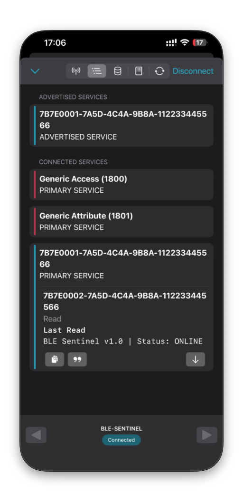
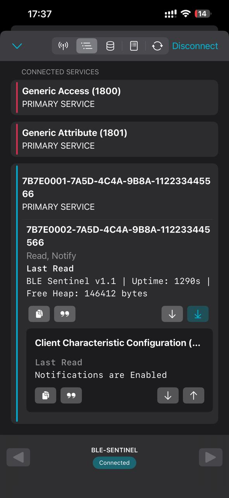
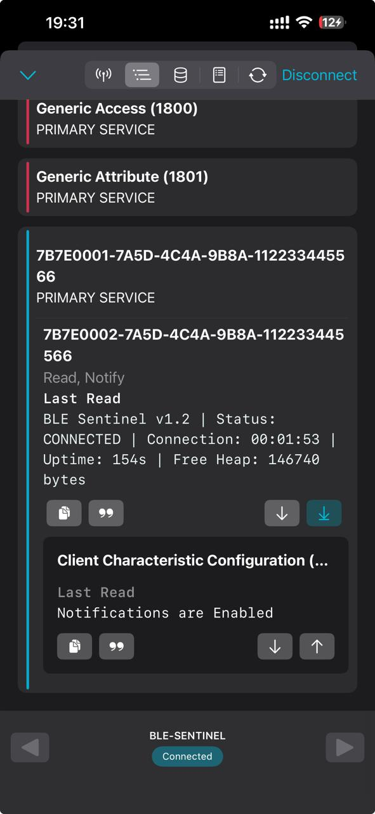

# BLE Sentinel

### ESP32-Based Bluetooth Low Energy Proximity Analysis & Security Lab

BLE Sentinel is an embedded-systems project exploring Bluetooth Low Energy
(BLE), wireless device discovery, GATT communication, and signal-strength
analysis using an ESP32 and an iPhone.

## Project Goals

- Implement a custom BLE beacon using an ESP32.
- Create a custom GATT service and characteristic.
- Discover and connect to the device using an iPhone.
- Investigate RSSI-based signal-strength measurements.
- Analyse experimental data using Python.
- Explore BLE security and access-control mechanisms.

## Hardware

- ESP32-WROOM-32U development board
- MacBook Air running macOS
- iPhone
- USB data cable

## Technologies

- Arduino C++
- ESP32 Arduino Core
- Bluetooth Low Energy (BLE)
- Generic Attribute Profile (GATT)
- nRF Connect for Mobile
- Git and GitHub
- Python (planned)

## Current Implementation

### BLE Beacon

Device name: `BLE-SENTINEL`

### Custom GATT Service

Service UUID:

`7b7e0001-7a5d-4c4a-9b8a-112233445566`

Characteristic UUID:

`7b7e0002-7a5d-4c4a-9b8a-112233445566`

Characteristic value:

`BLE Sentinel v1.0 | Status: ONLINE`
## Hardware Test Evidence

The ESP32 successfully advertised its BLE service and established
a connection with an iPhone using nRF Connect for Mobile.

The custom GATT characteristic was read successfully, returning
the expected status message.

## v1.1 — Live BLE Notifications

BLE Sentinel v1.1 adds live notifications to the custom GATT
characteristic.

The ESP32 periodically reports:
- Device uptime
- Available heap memory

Notifications were enabled and tested using nRF Connect
for Mobile on an iPhone.

### Notification Test Evidence

## v1.2 — BLE Connection Duration Tracking

BLE Sentinel v1.2 introduces connection-duration tracking
for a connected BLE client.

### Features

- Tracks the duration of the current BLE connection.
- Reports connection status.
- Continues monitoring ESP32 uptime.
- Reports available ESP32 heap memory.
- Sends periodic updates through BLE notifications.
- Restarts the connection timer when a new connection session begins.

### Testing

The firmware was uploaded to an ESP32-WROOM-32U development
board and tested using nRF Connect for Mobile on an iPhone.

The connection-duration value was observed updating through
BLE notifications.

### Test Evidence

# BLE Sentinel v1.3 — RSSI Distance Experiment

## Objective

Investigate the relationship between the distance between
an ESP32 BLE device and an iPhone and the received signal
strength indicator (RSSI).

## Method

The ESP32 advertised its BLE service, and an iPhone running
nRF Connect for Mobile measured the received signal strength
at different distances.

Three readings were taken at each distance, and the average
was recorded.

## Results

| Distance | Average RSSI |
|---:|---:|
| 0.5 m | -68 dBm |
| 1 m | -83 dBm |
| 2 m | -86 dBm |
| 3 m | -90 dBm |
| 4 m | -96 dBm |
| 5 m | -99 dBm |

## Observation

The average RSSI generally decreased as the distance
increased. The reading changed from -68 dBm at 0.5 m to
-99 dBm at 5 m.

This represents a 31 dB decrease in received signal strength.

## Limitations

RSSI is affected by environmental conditions, antenna
orientation, reflections and interference. The measurements
do not establish a universal relationship between RSSI
and distance.

The starting reading of -61 dBm was excluded from the
distance comparison because its distance was not recorded.

## Conclusion

The experiment demonstrated that BLE signal strength can
vary with distance in the tested environment. Further tests
under different environmental conditions would help assess
the consistency of this relationship.

## Verified Results

- [x] ESP32 BLE initialization
- [x] BLE advertising
- [x] iPhone device discovery
- [x] GATT service discovery
- [x] Successful GATT connection
- [x] Reading the custom characteristic

## Development Roadmap

- [x] Initial BLE beacon
- [x] Custom GATT service
- [x] Initial iPhone communication test
- [ ] Live BLE status notifications
- [ ] RSSI experiments
- [ ] Python-based data analysis
- [ ] BLE security testing
- [ ] Technical documentation

## Security and Privacy

This project is intended for controlled BLE experimentation and
authorized security testing.

RSSI alone is not a reliable way to verify a device's identity or
physical proximity.

## License

This project is licensed under the MIT License.
See the `LICENSE` file for details.
